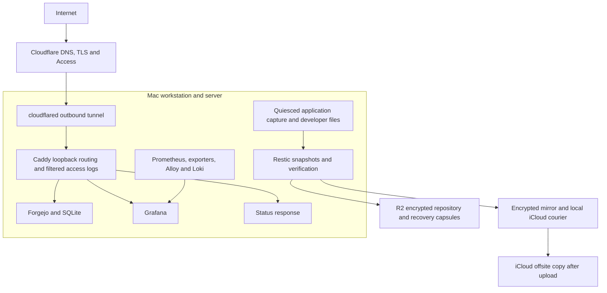

# Configuration

Personal macOS development environment and services, hosted on the Mac. Cloudflare
provides ingress, R2/iCloud provide offsite backups, and ntfy delivers notifications.
The applications, databases, metrics, logs, probes, and alert evaluation stay local.

## Existing host: deploy these changes

Updating the checkout does **not** install or activate the privileged runtime.
Review the diff and use a maintenance window: activation stops the old supervisors
and their services before starting the protected root supervisor. Do not run the
old tar backup job alongside the new one. Legacy backup archives are preserved.

```sh
mise install
mise run updates:check
```

Homebrew must be available before `mise run updates:pin`. Forgejo and Grafana are
currently reviewed at **16.0.4** and **13.2.2**. The check refuses other versions;
it does not silently migrate a database. `brew pin` freezes an installed formula,
not a historical installer. Exact-version reinstall may require a maintained tap
or vendor release; do not substitute a newer version without reviewing migrations.

Run `sh setup.sh` to perform the migration, including accounts, root-only key
permissions, protected runtime deployment, power policy, supervisor activation,
and Git authentication checks. It preserves an existing deployed fnox config
(including one recovered from a capsule) rather than replacing it with an older
Git copy. `mise run daemon:install` is the explicit way to deploy reviewed changes
to the repository's fnox config later.

For genuinely new, empty services, use `sh setup.sh --new`; both configuration and
robin checkouts must already exist. Ordinary setup refuses missing service state
and points to the recovery procedure instead of initializing over a failed restore.

After accepting the deployment:

```sh
mise run recovery:init
# Commit the reviewed configuration and robin changes before checkpointing.
mise run recovery:checkpoint
```

Initialization creates a new encrypted Restic password only if the repository
prefix is proven empty. It never replaces a lost password on an existing repository.
Keep the **OFFLINE_RECOVERY_RECORD** printed by checkpoint independently with an
offline age identity. It binds the snapshot, capsule, and bootstrap bundle hashes.
Neither a downloaded unsigned receipt nor encryption alone establishes who created
a recovery capsule. Never erase the host based solely on a local iCloud copy.

## Backup coverage and recovery

Restic replaces the custom tar/age retention engine, not the application-specific
capture procedure. The existing R2 credentials are reused at a new `restic-v1`
prefix; old daily/weekly/monthly archives are not deleted or migrated in place.

Captured data:

- `/Users/mac/Developer`, including private, ignored and uncommitted working files
  and `.git` directories. Dependency/build caches named `node_modules`, `.build`,
  `__pycache__`, `.cache` and `Caches` are excluded. Symlink targets outside the
  source tree are not followed.
- Independent configuration and robin Git bundles, including their exact HEADs.
- The entire Forgejo work tree, including its database, repositories, attachments,
  assets and generated identities inside that tree.
- Grafana's data tree and database. Prometheus/Loki history starts fresh on recovery.

Forgejo and Grafana pause only while their local state is copied. Previously
stopped services remain stopped. The exact newly created snapshot is restored and
checked, including manifests, Git integrity and SQLite integrity. A second check
validates the encrypted repository mirror used for iCloud. The courier copies
without deletion and reports **local handoff**, not confirmed Apple cloud upload.

This deliberately does not back up the whole Mac. iCloud documents remain your
separate document strategy. SSH user identities are recreated/registered or
recovered independently. Future web applications must add their persistent paths
and consistency procedure before their data becomes authoritative; no backup tool
can infer an application's storage boundary. See
[`services/backup/README.md`](services/backup/README.md) for exclusions, storage
costs, locking, retention, explicit snapshot selection, and resume behavior.

### Clean-machine recovery

1. Retain the offline age identity and the independently trusted recovery record.
   Check Cloudflare/iCloud account access separately. A capsule from iCloud contains
   the encrypted R2 credentials, avoiding the old credential-download cycle.
   For R2-only bootstrap, download through the Cloudflare account or independently
   retained read credentials; the operational age key alone cannot download R2.
2. Download the matching configuration bundle, capsule, receipt and, for offline
   recovery, **all** encrypted Restic repository objects listed by the receipt.
   Materialize iCloud placeholders before proceeding.
3. Verify the bundle's SHA-256 against your **independent record before cloning or
   executing code**. Clone into a temporary directory **outside** `~/Developer`.
   Install Command Line Tools if needed. Use the `mac` account at `/Users/mac`.
4. From that trusted temporary checkout run `recover.sh` with the downloaded
   capsule, retained identity, exact 64-character snapshot ID, and independent
   capsule SHA-256. An optional fifth argument selects a local Restic repository.
   See `sh recover.sh` for the argument order. It verifies the hash before capsule
   decryption, stages root-only tools/credentials without registering services,
   verifies the snapshot and installs the three absent target trees.
5. Restore maps saved account/group names to current IDs. It refuses existing
   unrelated targets. After an interruption, resume the installed restore command
   with the same snapshot and `--session reinstall-1 --offline`; do not initialize
   a fresh repository or remove an unexplained destination tree.
6. Inspect recovered application data, then run `sh setup.sh` from the restored
   `~/Developer/configuration` checkout. Test Forgejo, Git and a Grafana notification
   before accepting the recovered host.

The scripts are fixture-tested, not yet certified by an actual erased-host rehearsal.
Do a separate-volume/clean-host rehearsal and independently download/verify a cloud
copy before making a real reset depend on them. The copy stage does not guarantee
macOS resource forks, ACLs or arbitrary external application state. Allow disk space
for a full capture, verification restores and the encrypted mirror.

## Services and secrets

Pitchfork remains the single TOML service/scheduling interface; launchd starts it
at boot and restarts it after failure. Protected tools, Python, root launchers,
fnox config and boot configuration are deployed as root-owned regular files.
Root-executed code does not follow links into user-owned mise installations.

The operational age identity is **root-only**. Fixed launchers resolve one profile,
then drop to the service account with only its explicit secret variables. Services
cannot read the identity to decrypt another profile. Backup is intentionally
privileged so it can read private developer/service files and coordinate capture.
The deployment rejects executable fnox providers/hooks; adding one requires an
explicit trust-model change. See
[`services/security/README.md`](services/security/README.md).

Useful maintenance tasks:

- `mise run daemon:install`: deploy reviewed tools, loaders, fnox and boot config.
- `mise run daemon:reload`: deploy boot config only; **does not restart** services.
- `mise run daemon:activate`: explicitly stop legacy supervisors and activate root.
- `mise run recovery:verify SNAPSHOT_ID`: restore/check one exact snapshot privately.
- `mise run recovery:prune`: preview retention; `--apply` explicitly checks/prunes R2.

The local/iCloud encrypted mirrors deliberately retain historical objects; remote
pruning does not reclaim mirror space. Review that growth rather than introducing
an automatic delete propagation path again.

### SSH and Git

`mise run git:forgejo` configures both checkouts with Forgejo as `origin` and default
push target, preserving Entire/GitHub remotes. It performs no commits or pushes.

SSH is used in two ways:

- Git fetch/push to Forgejo's embedded SSH listener on `127.0.0.1:2222`. The user Git
  config rewrites `git@git.maclong.dev:` to that local listener on this Mac.
- Git commit/tag signing uses the SSH-format `~/.ssh/id_ed25519` identity; signing
  itself is not an SSH network connection.

No public SSH tunnel or macOS Remote Login is configured. Other clients use
`https://git.maclong.dev/mac/NAME.git` with appropriate Forgejo authentication, not
an assumed public port 22. Setup generates/registers a replacement user key if the
private key is absent; restored Forgejo server identities are part of its data tree.
Existing workflows under robin's `.forgejo` directory still need intentionally
provisioned compatible runners; changing remotes does not provision CI runners.

### Power and lid behavior

`mise run host:server` disables system sleep, sets the global sleep override and
enables automatic restart after power loss on AC. The lid override is
macOS/hardware-dependent: physically test closing the lid while checking the public
endpoint. Maintain ventilation and mains power. Never carry the awake closed Mac
in a bag. `mise run host:portable` re-enables sleep before portable use.

FileVault stays enabled. Updates/reboots are attended so disk unlock is handled
locally. Automatic restart does not bypass FileVault, and laptop battery behavior
can differ from desktop restart-after-power-loss behavior.

## Update policy and notifications

Pinned in `mise.toml`: service binaries, Python, Restic, fnox, Pitchfork, Node,
validation tooling, Entire, GitHub CLI, and mas. The bootstrap mise version is
pinned in setup/recovery and recorded in
[`services/maintenance/versions.toml`](services/maintenance/versions.toml).
Forgejo/Grafana have a checked baseline plus Homebrew pins. GUI apps/fonts/App Store
apps can remain rolling; database-owning services should not upgrade unattended.
macOS/Xcode updates remain an attended compatibility decision.

Every 30 days, Grafana sends an **Infrastructure update review overdue** alert
through the existing ntfy contact point. A missing timestamp also alerts. This is
a review reminder, not a claim that vulnerability/advisory feeds were checked.

Review checklist:

1. Review security advisories/release notes for every service and the bootstrap,
   validation and runtime versions above. Inspect `mise outdated` and Homebrew's
   outdated report; those commands need network access.
2. Create a verified recovery point before database-affecting upgrades.
3. Update pins/baselines, install tools and run `mise run test` plus native validators.
4. Deploy/activate during maintenance. Check public routing, scrape targets,
   backup success and a synthetic firing/resolved ntfy notification.
5. Only after completing review, run `mise run updates:reviewed` to reset the timer.

Prometheus scrape/evaluation and SoC sampling are 60 seconds. Access redirect checks
are explicitly distinguished from local application probes. Raw access logs remove
Cloudflare Access assertions/email before disk writes; Alloy labels and scrubs IPs
before Loki. Monitor the APFS Data volume and collector freshness, not just scrape
process availability. No active Caddy upstream check is implied by its routing
eligibility panel.

For an optional independent availability exception, use **UptimeRobot** to check
`https://status.maclong.dev` from outside the house. A same-Mac monitor cannot
report total host/network failure. No external monitor account or data integration
is configured here. Keep all detailed metrics/logs local.

## Mail, editor and shell

Direct outbound Postfix delivery is intentional. Keep testing recipient acceptance,
DNS and queue behavior; current junk placement is accepted. Neither an SMTP relay
nor a hosted mail provider is introduced by this setup.

Zed is included in Homebrew casks. tmux title/integration commands are removed. One
`start-tmux=no` setting remains because deleting it would make zsh4humans enable
its bundled multiplexer by default; this explicitly prevents its use.

## Validation

`mise run test` runs local Restic/recovery fixtures, security/deployment fixtures,
observability fixtures, shell lint/syntax checks and the SoC smoke test. The fixtures
use temporary keys, repositories and loopback servers, not production credentials
or service control. Native validators are also configured in `hk.pkl`.

Fixture success does not establish R2 permissions, iCloud upload, TCC/Full Disk
Access, actual lid behavior, authenticated public routing or real ntfy delivery.

## Architecture


